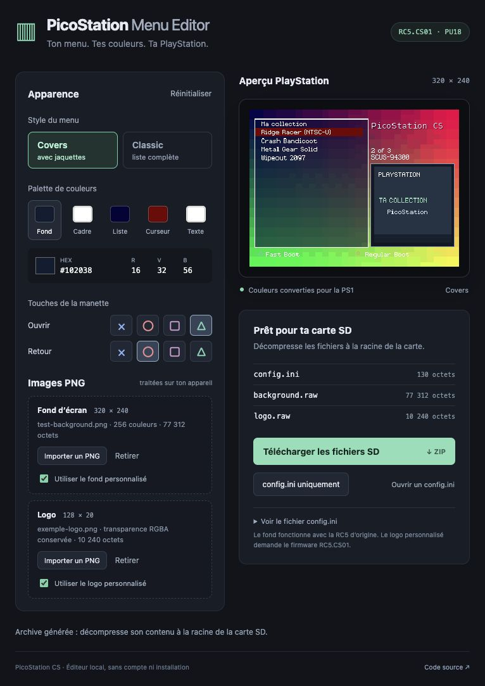

# PicoStation CS

Fork de [megavolt85/PicoStation](https://github.com/megavolt85/PicoStation), pour personnaliser le menu **RC5** : configuration, fond 320×240 et logo 128×20 avec transparence PNG.

La première version **RC5.CS01** cible la **PS1 PU18, Pico RP2040, sans overclock**. Le firmware CS01 est expérimental et n’a pas encore été validé sur console. Aucun script ne flashe automatiquement le Pico.

## PicoStation Menu Editor

Ouvre `PicoStation Menu Editor/Lancer.command` sur macOS, ou lance depuis la racine du dépôt :

```sh
python3 tools/serve_editor.py
```

L’éditeur s’ouvre dans le navigateur et travaille entièrement sur ton ordinateur. Il propose les cinq couleurs du menu, les styles Covers/Classic, les boutons Ouvrir/Retour, l’import des PNG aux dimensions attendues, l’aperçu, l’import et la réinitialisation de configuration, et l’export INI/ZIP.

Le ZIP contient les fichiers directement à placer à la racine de la carte SD. Le sélecteur de langue est volontairement absent. [Détails de l’éditeur](PicoStation%20Menu%20Editor/README.md).



## Firmware : reconstruction vérifiable et extension en C

Les sources C/C++ originales de la RC5 de juillet 2026 ne sont pas publiées dans les dépôts amont consultés. Ce fork **ne prétend pas les avoir retrouvées**.

La base dans `rc5/original/` est une représentation assembleur sans perte du firmware RC5 fourni. Sa compilation produit un UF2 **identique octet pour octet** à la RC5 PU18 non overclockée. Les nouvelles fonctions du logo sont écrites en C dans `rc5/patches/`, puis intégrées à cette base. Les anciennes sources C++ amont sont conservées avec leur historique.

```sh
git submodule update --init third_party/ucl
python3 tools/rc5/build.py
```

Le build produit une RC5 reconstruite et un `picostation_PU18_RC5.CS01-experimental.uf2` dans `build-cs/`. Consulte [les prérequis, les formats, les tests et les limites](rc5/README.md) avant d’utiliser les fichiers.

## Fichiers SD

| Fichier | Fonction |
|---|---|
| `config.ini` | Couleurs, style, boutons, activation du fond et du logo |
| `background.raw` | Fond indexé 320×240, 77312 octets, compatible RC5 |
| `logo.raw` | RGBA8888 128×20, 10240 octets, nécessite CS01 |

Le logo original reste disponible lorsque le logo externe est désactivé, absent ou invalide. Les semi-transparences PNG sont composées avec le fond au chargement.

Les fonctions RC5 existantes sont conservées dans la base. Les essais exécutent le nouveau code ARM/MIPS avec les accès SD/GPU simulés et vérifient le décompactage ainsi que les checksums CD. Le démarrage, les jeux, les cartes mémoire, le son, les cheats et les options restent à vérifier sur le matériel avec CS01.

## Origine

[README amont conservé](docs/README-amont.md) · [PicoStation](https://github.com/megavolt85/PicoStation) · [Menu amont](https://github.com/megavolt85/picostation-menu) · [Jaquettes](https://github.com/megavolt85/picostation-covers) · [Licences et crédits](NOTICE).
